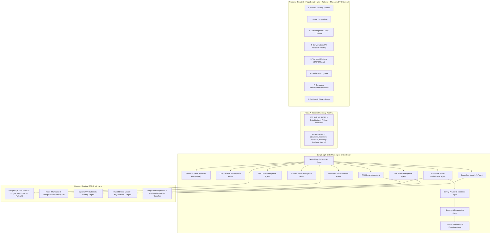
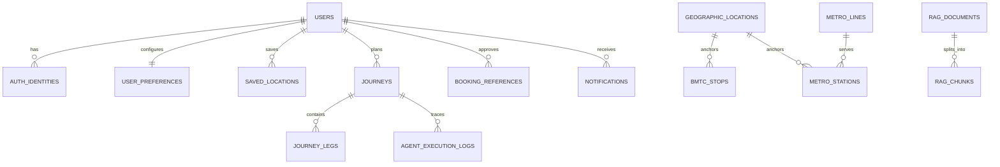
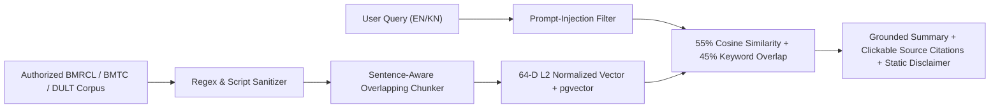

# TripBuddy AI — System, Multi-Agent, Database, RAG, and Geospatial Architecture

## 1. System Architecture Diagram



## 2. Multi-Agent Architecture & Responsibilities

| Agent Name | Permission Scope | Allowed Tools | Timeout | Fallback Behaviour |
| :--- | :--- | :--- | :--- | :--- |
| `PersonalTravelAssistantAgent` | `read_user_preferences_and_nlp` | `nlp_pipeline.parse_query`, `llm_service` | 6.0s | Deterministic rule/regex NLP parser (EN & KN) |
| `LiveLocationAndGeospatialAgent` | `geospatial_lookup_consented` | `geocoding.resolve_place`, `search_locations` | 4.0s | Verified Bengaluru static gazetteer lookup |
| `LiveTrafficIntelligenceAgent` | `read_traffic_feeds` | `traffic.get_corridor_conditions`, `travel_time_model` | 4.0s | Labeled Bengaluru peak-corridor congestion model |
| `BMTCBusIntelligenceAgent` | `read_bmtc_gtfs` | `bmtc.lookup_stops_and_routes` | 5.0s | Labeled BMTC GTFS schedule & headway fixture |
| `NammaMetroIntelligenceAgent` | `read_bmrcl_metro` | `metro.lookup_stations_and_lines` | 5.0s | Verified BMRCL Purple/Green Line timetable |
| `MultimodalRouteOptimizationAgent` | `compute_routes` | `routing_engine.plan_multimodal_routes` | 8.0s | Relaxed walking-radius multimodal graph search |
| `BookingAndReservationAgent` | `booking_handoff_requires_explicit_user_approval` | `booking.prepare_official_options` | 5.0s | Verified official BMRCL/BMTC/Namma Yatri portals |
| `WeatherAndEnvironmentalAgent` | `read_weather` | `weather.get_current_weather` | 4.0s | Seasonal Bengaluru forecast fixture |
| `BengaluruLocalInformationAgent` | `read_civic_advisories` | `news.get_alerts`, `alert_classifier` | 4.0s | Cached verified civic/BTP advisories |
| `RAGKnowledgeAgent` | `read_sanitized_knowledge_corpus` | `rag_pipeline.retrieve` | 5.0s | Keyword + hashed n-gram vector retrieval |
| `JourneyMonitoringAndProactiveAgent` | `monitor_consented_active_journey` | `traffic`, `notifications.dispatch` | 5.0s | Skips execution when tracking consent is off |
| `SafetyPrivacyAndValidationAgent` | `validation_and_policy_gate` | `validate_routes`, `check_prompt_injection` | 4.0s | Rejects discontinuous legs & sanitizes prompts |

## 3. Journey-Planning Sequence Diagram

```mermaid
sequenceDiagram
    participant U as Commuter (Browser/Mobile)
    participant API as FastAPI (/api/v1/journeys/plan)
    participant O as TripOrchestrator
    participant NLP as PersonalTravelAssistantAgent
    participant GEO as LiveLocationAndGeospatialAgent
    participant PAR as Parallel Agents (Traffic, Weather, BMTC, Metro, News, RAG)
    participant RT as MultimodalRouteOptimizationAgent
    participant SAF as SafetyPrivacyAndValidationAgent

    U->>API: POST /api/v1/journeys/plan (Origin, Destination, NL Query)
    API->>O: execute_journey_planning_workflow()
    O->>NLP: extract_intent(query)
    NLP-->>O: ExtractedTravelIntent (EN/KN, constraints)
    O->>GEO: resolve_endpoints(origin, destination)
    GEO-->>O: Verified Bengaluru Coordinates (EPSG:4326)
    par Concurrent Specialist Retrieval
        O->>PAR: Fetch Traffic, Weather, BMTC, Metro, Advisories & RAG Chunks
    end
    PAR-->>O: Grounded Context + Source Freshness Labels
    O->>RT: optimize_routes(origin_id, destination_id, constraints)
    RT-->>O: Fastest, Cheapest & Best-Balanced Route Alternatives
    O->>SAF: validate_all(alternatives, prompt_injection_check)
    SAF-->>O: Validation Verdict + Continuity Check
    O-->>API: Structured JourneyPlanResponse + Citations + Traces
    API-->>U: Render Synchronized Map Polylines & Comparison Cards
```

## 4. Database Entity-Relationship Diagram



## 5. RAG Pipeline & Prompt-Injection Defense Diagram



## 6. Provider Integration Matrix

| Provider Domain | Adapter Class | Demo Mode Source | Live Mode Requirement | Freshness Label |
| :--- | :--- | :--- | :--- | :--- |
| Geocoding & Search | `GeocodingProvider` | Verified Bengaluru Gazetteer (12 core hubs) | Nominatim OSM / Commercial API Key | `VERIFIED_STATIC_GAZETTEER_2026` |
| Maps & Road Routing | `MapsAndRoadRoutingProvider` | Pedestrian & Corridor Graph | `OSRM_BASE_URL` / MapLibre Tile Server | `CORRIDOR_GRAPH_VERIFIED` |
| Bengaluru Traffic | `TrafficProvider` | Peak Corridor Congestion Model | `TRAFFIC_API_KEY` (TomTom / HERE) | `SIMULATED_PEAK_CORRIDOR_FIXTURE` |
| Weather | `WeatherProvider` | Bengaluru Seasonal Fixture | Open-Meteo API (`WEATHER_API_URL`) | `SEASONAL_FORECAST_FIXTURE` |
| BMTC Buses | `BMTCProvider` | Validated Corridor Schedule Fixture | Institutional `BMTC_API_KEY` & GTFS-RT URL | `SCHEDULE_AND_DEMO_FIXTURE` |
| Namma Metro | `NammaMetroProvider` | Verified Purple/Green Line Timetable | Official BMRCL Partner Feed | `VERIFIED_BMRCL_TIMETABLE_FIXTURE` |
| Civic Advisories | `NewsAndAdvisoryProvider` | Verified BTP / BMRCL / BBMP Fixtures | Authorized RSS/Civic Webhook | `VERIFIED_CIVIC_FIXTURE` |
| Official Bookings | `BookingProvider` | Official Portal Handoff (Approval Gated) | Partner Ticketing Webhook | `VERIFIED_OFFICIAL_PORTALS` |
| Notifications | `NotificationProvider` | Real-Time In-App Deduplicated Bus | Web Push VAPID Keys (for closed-tab push) | `REALTIME_INTERNAL_BUS` |
| LLM & Embeddings | `LLMProviderService` | Deterministic Local Hybrid Engine | `LLM_API_KEY` (OpenAI-compatible / Gemini) | `ACTIVE_LOCAL_AND_HYBRID_ENGINE` |
